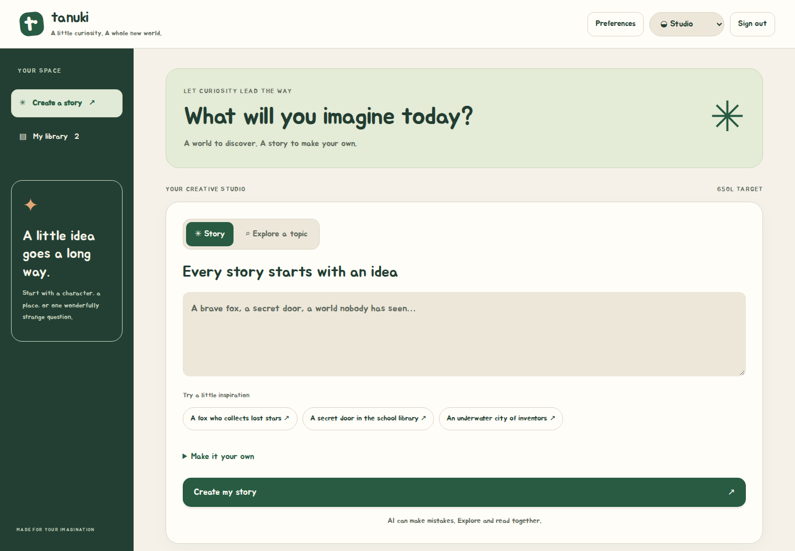
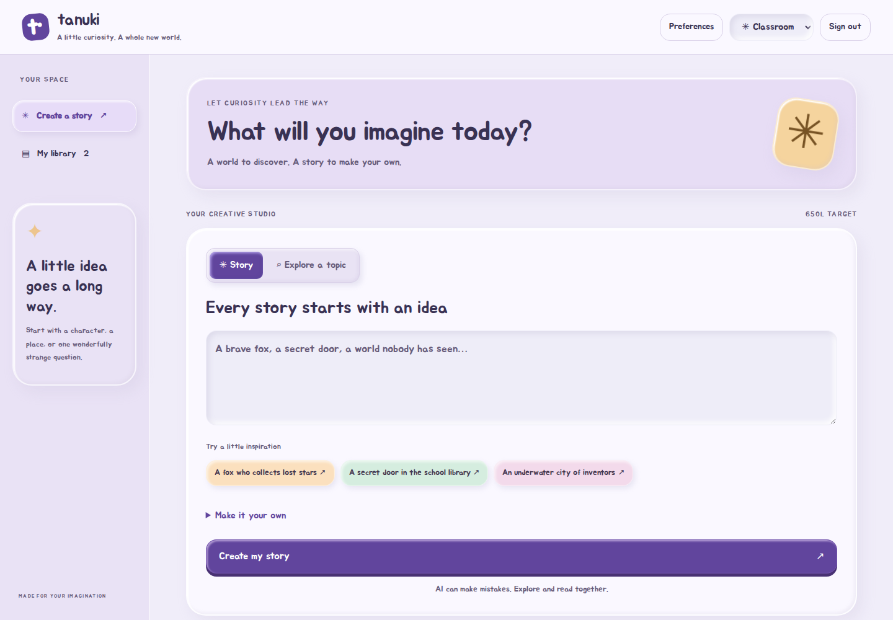
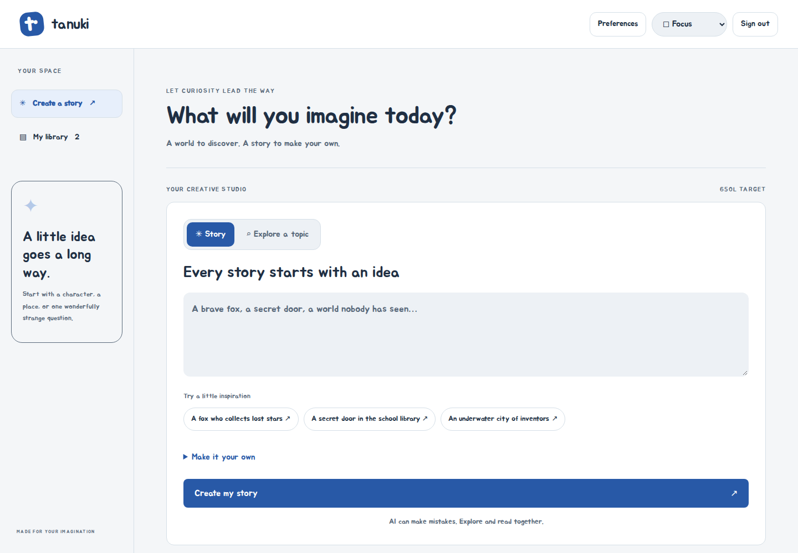
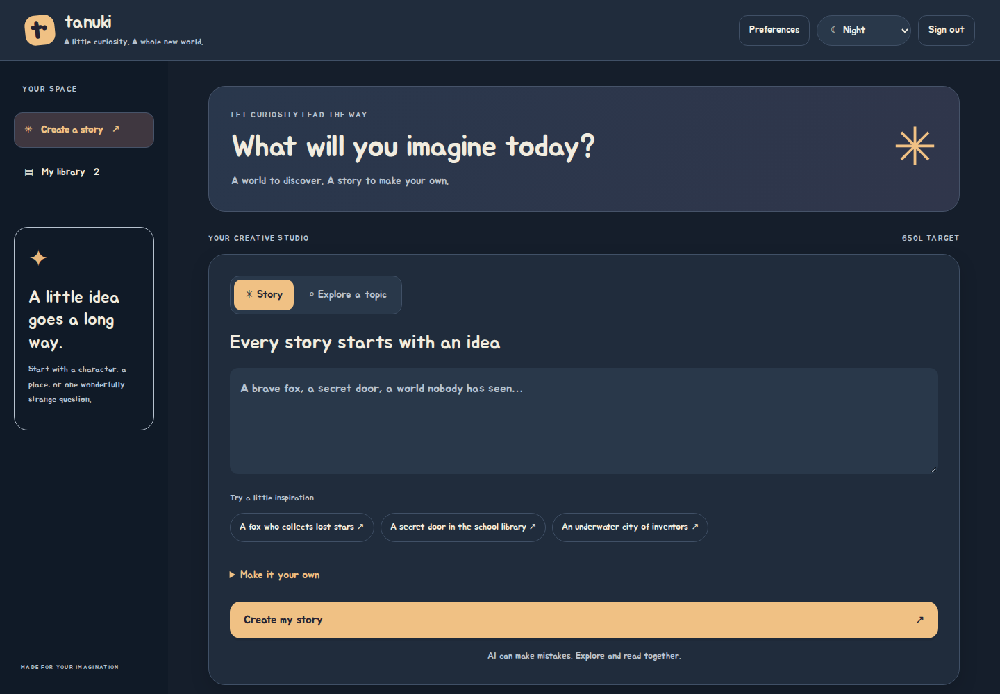

# Tanuki Stories

A Node.js and vanilla JavaScript reading workspace with student, teacher, and administrator accounts. Studio, claymorphic Classroom, Focus, and Night themes use a locally hosted Jua font. Students set a **0–1800L Lexile writing target in 50L steps** with an accessible slider. This target is a generation instruction, not a certified measurement; teacher reading levels and content restrictions remain authoritative.



| Classroom | Focus | Night |
| --- | --- | --- |
|  |  |  |

Explore the [screenshot tour](docs/SCREENSHOTS.md) for the actual website, reader, teacher/admin
dashboards, mobile layout, Lexile preferences and graphical server installation. All website
examples use synthetic data.

## Run locally

For self-contained Windows, macOS (Intel/Apple Silicon), and Linux installers, see
[installable releases and production rollout](docs/RELEASES.md). They include Node and a
graphical setup wizard; the source-development commands below are not required by end users.

Use Node.js **26.13.0 or newer within 26.x**, with SQLite **3.54.0+**. Older runtimes are rejected before application or worker databases open. Release bundles pin the tested runtime.

```sh
npm ci
npm run dev
```

Open http://localhost:3000. Development creates `admin / admin123` and `student / student123`, plus a development encryption key in `.secrets`. **Do not reuse this development database or its credentials in production.** Development returns clearly marked demo stories until an AI provider is configured.

The active application is `server/`, `public/index.html`, and `public/assets/`. It has no bundler, Next.js, React, or TypeScript runtime. Its cryptographic dependencies provide native Rust Argon2id, Noble AES-GCM-SIV/PQ/browser hashing, browser Argon2 WASM, and OpenPGP legacy-read compatibility. New encryption uses the [AES-256-GCM-SIV / Argon2id / HKDF-SHA-512 / ML-KEM-1024 / ML-DSA-87 stack](docs/security/CRYPTO_STACK.md), with native OpenSSL PQ operations on the server. Historical `src/`, framework configuration and Selenium tests remain inactive. The shared Tauri desktop/mobile client is in `src-tauri/` with a vanilla JavaScript launcher in `clients/web/`. The current `install.bat` / `install.sh` scripts launch verified server graphical setup from portable release bundles. [Windows, macOS, Linux, Android and iOS clients](docs/MOBILE.md) connect by HTTPS domain or IP to the same server used by modern browsers.

## Features

The opt-in [Trusted Worker Encryption architecture](docs/security/TRUSTED_WORKER.md) moves AI plaintext processing to a separately confined worker. It provides signed, recipient-encrypted, resumable responses and client-side decryption. The worker and provider see plaintext; this is not AI-stage E2EE. Provisioning, current test evidence, unfinished workflows and rollout limitations are documented there. Both preview flags default off.

- Students: story and nonfiction prompts, reviewed story plans, streamed chapters, library search, editing, browser print/PDF, reading text size, voice recordings, and saved preferences.
- Teachers: assigned classroom settings and student reading settings, with server-enforced roster isolation.
- Administrators: student/teacher accounts, CSV import, classroom membership, disabled accounts, activity, knowledge documents, AI endpoints and content settings.
- SQLite transactions, opaque revocable sessions, encrypted record payloads and new recordings, and atomic legacy JSON import.

Local inference is supported through an **OpenAI-compatible HTTP endpoint**, not an embedded Transformers runtime. Knowledge retrieval uses local lexical matching. Browser printing exports the currently displayed chapter. Old native desktop packaging and embedded model management are not part of this runtime.

## Tests and reports

```sh
npx playwright install chromium
npm test
npm run test:coverage
npm run coverage:report
npm run build
npm run crypto:benchmark
```

Tests use Node's built-in runner, isolated temporary SQLite databases, real HTTP requests, real cryptography, Chromium, and deterministic local provider fixtures. No production provider account is required. `coverage/report.html` and `coverage/summary.json` are generated alongside LCOV and raw browser V8 coverage. See [the verification report](docs/TEST_REPORT.md) and [WSL production-like results](docs/WSL_TEST_REPORT.md) for the actual runs, scope, and gaps.

## Production

Read [deployment and recovery](docs/DEPLOYMENT.md) and [security boundaries](docs/SECURITY.md) before deploying. Passing tests does not establish production readiness.

The [adversarial security assessment](docs/security/ASSESSMENT.md) documents confirmed fixes and remaining release blockers. Existing databases require a backed-up offline `npm run data:upgrade`; production refuses known plaintext migration JSON until `npm run data:archive-legacy` verifies and archives it.

Security transparency: [before/after Mermaid attack graphs](docs/security/ATTACK_PATHS.md), [every assessment finding](docs/security/FINDINGS.md), [sanitized evidence logs](docs/security/evidence/README.md), and [local PoC sources](docs/security/pocs/README.md).

## Recipient-encryption preview

`TANUKI_RECIPIENT_ENCRYPTION=1` exposes a separate encrypted workspace for isolated evaluation.
It supports client-encrypted private/classroom drafts, verified recipient fingerprints and a
durable, recipient-encrypted AI response queue that survives browser disconnection. AI prompts
and generated output still pass through the server/provider in plaintext during processing.
The full legacy-reader migration, encrypted feedback and public-publishing workflows are not
finished. Keep the feature disabled for sensitive rollout. Read the
[architecture, verification evidence and remaining blockers](docs/security/RECIPIENT_ENCRYPTION.md).

Teachers can explore classroom participation, daily creation trends, reading-level settings, and individual activity in the [statistics overview](docs/TEACHER-STATISTICS.md).

The latest [dependency security review](docs/security/DEPENDENCY_AUDIT.md) documents a production-release hold for unresolved bundled-runtime advisories, plus the build-tool remediations and scan evidence.
