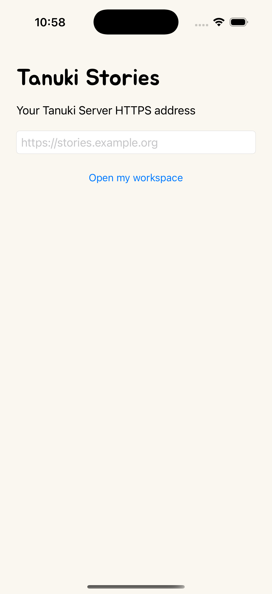

# Historical native-shell implementation

Superseded by the Tauri clients in [MOBILE.md](MOBILE.md). Retained for migration evidence and original policy tests.

# Android and iOS clients

See the [website and installer screenshot gallery](SCREENSHOTS.md) for all four themes and
the responsive classroom workspace. This native capture comes from the verified iOS simulator
run, not a physical-device acceptance test.

These apps connect to an existing HTTPS Tanuki Server; they do not run Node, SQLite or AI
generation on the phone. The server retains its independent generation worker and resumable
response architecture. Native shells use Android WebView and iOS WKWebView with no JavaScript
bridge or third-party runtime. The hosted application supplies its Jua UI and four themes.

## Build outputs

The `Build mobile clients` GitHub workflow builds:

- `Tanuki-Android-test.apk`: signed using an ephemeral Android debug identity, for isolated
  testing only. Successive builds may need uninstalling the prior test app because keys differ.
- `Tanuki-Android-release-unsigned.apk`: production build requiring your stable Android signing
  key before distribution. Sign with Android SDK `apksigner`, verify it, then distribute.
- `Tanuki-iOS-UNSIGNED.ipa`: a correctly packaged device app **without a signing identity**.
  It is not installable on physical iPhones. The unsigned Xcode archive and a simulator app
  accompany it. This is not an App Store or TestFlight release.

Android requires JDK 17, Gradle 8.14.6 and Android SDK 36. Run `gradle :app:assembleDebug
:app:assembleRelease :app:lintRelease` from `mobile/android`. The CI download verifies the
pinned Gradle distribution SHA-256. No server credentials or signing secrets belong in Git.

For an installable IPA, open `mobile/ios/Tanuki.xcodeproj` in Xcode, select your Apple team
and an app identifier owned by that team, and provision the intended distribution method.
Use Xcode Archive/Distribute, or set `TANUKI_APPLE_TEAM` and `TANUKI_EXPORT_OPTIONS` (absolute
path to your reviewed ExportOptions.plist) then run `sh mobile/ios/export-signed.sh` on a Mac
with the relevant certificate/private key already in its keychain. Apple signing assets are
not generated or bypassed by CI. See [Apple distribution signing](https://help.apple.com/xcode/mac/current/en.lproj/devcac6ab5b3.html).

## Security and acceptance limits

Enter only the HTTPS origin your administrator provides. Scheme, hostname and effective port
must match for workspace navigation; credentials in URLs and foreign origins are rejected.
Normal OS TLS validation remains enabled. Android disables cleartext traffic, file/content
access, third-party cookies, backups, screenshots and WebView debugging. iOS uses an ephemeral
website data store; closing/reopening the workspace loses that session and local preferences.
The native server-address preference contains no credentials. Android clears web cookies and
storage before opening a workspace; local preferences are not a durable backup on either app.

No microphone, camera, file picker, download handler, notification or native JavaScript bridge
is implemented in this initial client. Reading-recording uploads and encrypted key-backup file
flows therefore need browser use and further native implementation/acceptance. An interrupted
network is not an instruction to cancel generation. Feature support and authenticated content
remain subject to the server's existing policy and preview flags.

URL-policy assertions, native compilation and Android lint are automated. Physical-device login,
classroom use, encrypted content, server switching, accessibility, background/reconnect behavior
and OS-version compatibility still require acceptance testing before distribution. Passing a
build is not evidence that all web features work inside mobile WebViews. Store acceptance of
a web-based client has not been evaluated.

## Verification checkpoint — 2026-11-10

Source `9729b05` is tracked by the [mobile build run](https://github.com/Colin1337X/Tanuki/actions/runs/42716071897).
Android passed 19 URL-policy assertions, debug/release compilation, release lint and debug
APK signature verification. iOS passed 18 URL-policy assertions, simulator/device compilation
and unsigned IPA packaging. These assertion counts are not additional Node test-case counts.
The workflow also attempts an installed iOS simulator launch and records a screenshot; consult
the run's final status for that check. Physical-device acceptance remains outstanding.

The [server installer run](https://github.com/Colin1337X/Tanuki/actions/runs/42715785826)
passed on all four OS/architecture targets, including actual script-entry integrity checks and
native installation/login tests. The shared GUI passed all 10 installer regressions locally
in isolated WSL2, with zero failures or skips; the complete CI application suite passed 680.

