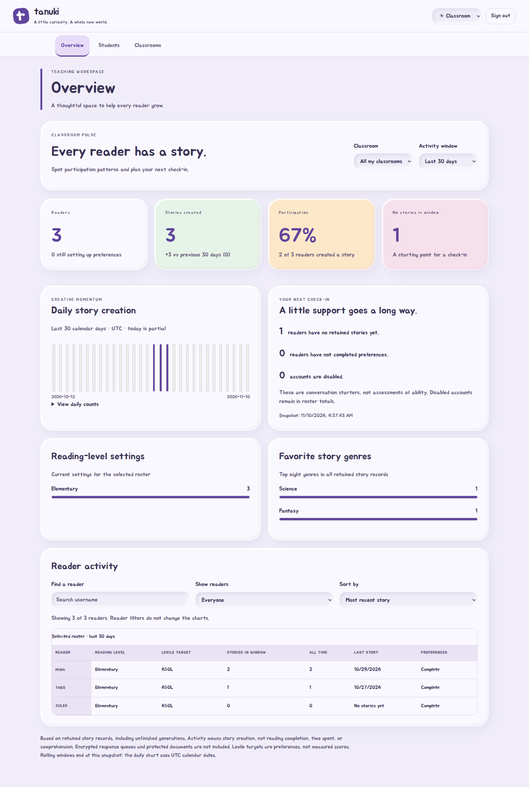

# Teacher statistics

Open **Overview** in the teaching workspace. Administrators see the same statistics across current student accounts; teachers see only students belonging to their currently managed classrooms. Overlapping memberships count once in combined totals.

- Choose a classroom and a rolling 7-day, 30-day, or all-time activity window.
- Compare story creation with the previous equal-length window, participation, and readers without stories in the selected window.
- Inspect daily UTC counts in the chart or its accessible data table. Calendar-day buckets differ from the rolling windows; today is partial.
- Review current reading-level settings, the top eight all-time story genres, incomplete preferences, and disabled accounts.
- Search readers, filter for follow-up, or sort by recent story, number of stories, or username. The reader-table filters leave the overview charts unchanged.
- See each reader’s configured Lexile target, story totals, last story date, and preference completion.

## What the numbers mean

These statistics summarize **retained ordinary story records**, including unfinished generations. They do not measure reading completion, time spent, proficiency, or comprehension. A Lexile target is a preference, not a measured score. Deleted stories disappear from totals; disabled accounts remain in roster totals. Invalid and future timestamps are excluded. Accounts no longer present in the student roster are excluded.

Encrypted response queues and protected documents are deliberately excluded: this page does not decrypt content or infer metrics from unavailable text. No new tracking events or analytics dependencies are introduced. A future encrypted-content analytics design needs explicit metadata and recipient policy review.

Each page load obtains a fresh snapshot; classroom and period filtering then operate on that authorized snapshot. Reopening Overview refreshes it. As with any already-rendered page, revocation cannot erase information a teacher previously received. Subsequent requests recheck authentication and classroom membership, and API responses remain private and non-cacheable.

## Verification

Deterministic aggregation tests cover rolling-window boundaries, invalid dates, UTC buckets, overlapping classrooms, empty rosters, unusual property names, and the metadata-only response contract. HTTP tests cover teacher isolation, unassigned teachers, and student denial; existing session and response-cache security tests remain in place. Chromium tests exercise all four themes at mobile and desktop widths, filter controls, sorting, empty states, and daily counts.

Large-school throughput, screen-reader compatibility across products, and non-Chromium rendering have not been established by these checks. Aggregation currently reads retained stories into memory; this is not a large-dataset performance claim.

Final isolated WSL verification (November 10, 2026): **717 passed, 0 failed, 0 skipped**, including 96 application browser cases. All 134 JavaScript modules passed syntax checks. The full coverage report includes the new server aggregation module and Chromium execution ranges for statistics.js; these are distinct metrics, not proof of full branch or accessibility coverage.
