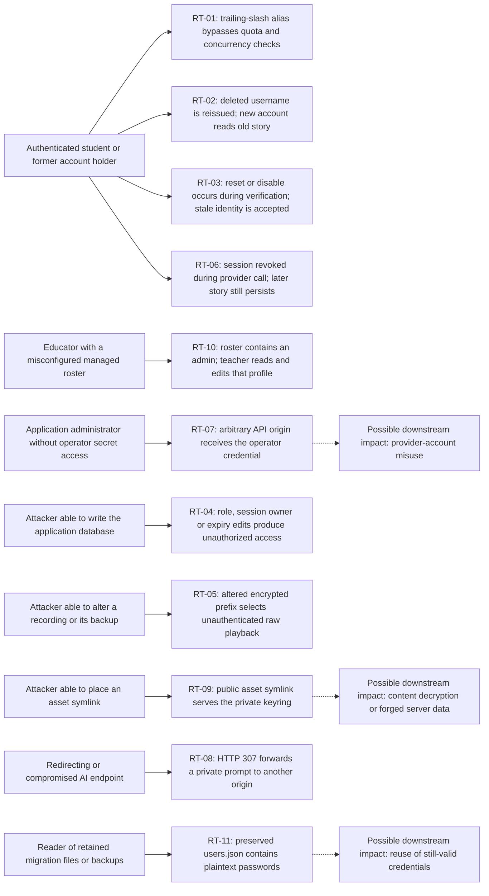
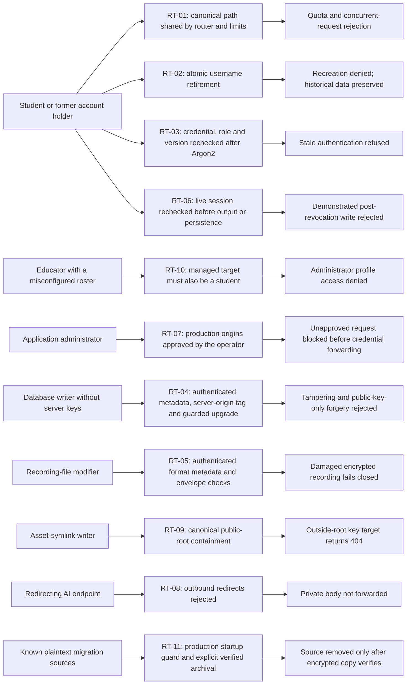

# Attack paths before and after hardening

GitHub renders the fenced `mermaid` graphs below using Mermaid. These describe **how the confirmed weaknesses could affect a live installation with the stated prerequisites**. They are not records of attacks on a real deployment: all reproduced behavior used synthetic local fixtures. See [every finding and its evidence](FINDINGS.md) and the [full assessment](ASSESSMENT.md).

## Before: reachable weaknesses at different trust boundaries

Solid edges summarize behavior reproduced locally. Dotted edges are plausible downstream consequences **not separately executed as full attack chains**. RT-03 was reproduced deterministically at the real asynchronous authentication boundary, not as a timed attack against a live remote login. RT-10 changed profile settings; it did not demonstrate a teacher changing the administrator's password or role. RT-05 returned unauthenticated bytes; it did not recover plaintext by breaking AES.

## After: controls at the corresponding boundary

These are verified controls, not universal guarantees. RT-11 needs the operator to run the archive step; it cannot retract an external copy already made. Restoring historical snapshots can restore historical authorization state. The origin allowlist is not an egress firewall or DNS-pinning control. The symlink fix is not a sandbox against full service-account compromise. Existing legacy raw audio has an explicit compatibility exception.

## Inspect and reproduce

- [Finding-by-finding prerequisites, subcases and source links](FINDINGS.md)
- [Sanitized raw transcripts and provenance](evidence/README.md)
- [Actual local PoC/regression scripts and safe invocation](pocs/README.md)
- [Remaining release blockers](REMEDIATION_BACKLOG.md)

The application uses **server-side encryption, not E2EE**. Public ML-KEM keys need not be confidential; private keys and the derived server-origin authentication key must remain private. Independent review of the application-specific envelope and actual deployment infrastructure is still required.
