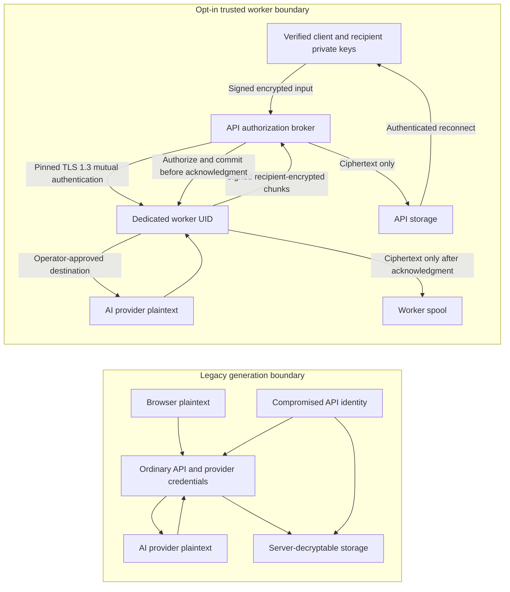

# Trusted Worker Encryption checkpoint

**Cryptography update:** [the new PQ stack and migration guide](CRYPTO_STACK.md)
supersede this checkpoint's OpenPGP new-write algorithms. The 682-execution results below
remain historical; the later report contains results for the new stack.

This is an opt-in implementation checkpoint, not approval for a production rollout or an independent security audit. The secure generation path uses a separate Linux worker process and OS identity. The browser encrypts a signed request to that worker; the ordinary API forwards ciphertext. The worker and the configured AI provider process plaintext. This is **Trusted Worker Encryption**, not end-to-end secrecy from the AI processor.

## Boundaries and protocol

The worker artifact contains only its daemon, engine, AI client, generation policy, recipient crypto wrapper, verifier, and pinned OpenPGP.js dependency. It does not import application authentication or database modules. Its processing key is distinct from recipient private keys and cannot decrypt stored response chunks. The API holds a TLS client credential, not the worker processing key. Worker RPC accepts only bounded operations; provider URL, credentials and model are operator configuration, not request fields.

Recipient encryption uses OpenPGP.js 6.3.2, RFC 9580 version-6 Curve25519 keys and authenticated SEIPD-v2 AES-256-GCM packets, with Ed25519 signatures. This is a separate protocol from existing server storage's ML-KEM-1024/HKDF/AES-256-GCM-SIV envelope and Argon2id credentials. It does not claim post-quantum recipient encryption. Existing cryptographic vector tests remain; no cryptographic verification is mocked. Full independent OpenPGP interoperability/vector conformance and cryptographic audit remain outstanding.

Each response binds version, purpose, generation, owner, recipient fingerprints, worker fingerprint, sequence and previous ciphertext hash. The worker signs both the encrypted content and a public ciphertext frame. The API can authenticate a frame without decrypting it; the browser verifies the signature and context before reconstruction. Actual public-key bytes must match independently pinned fingerprints at every use. API-provided labels alone are insufficient (PRE-02).

Generation continues independently of the browser connection. The API coordinator rechecks session, account, device and recipient policy before each durable chunk commit, then acknowledges that commit to the worker. The worker persists only after this acknowledgment. A short authorization lease alone would allow output to be persisted after revocation; the per-chunk handshake closes that window. Already committed ciphertext and plaintext already received by recipients cannot be retroactively revoked.

API restart reconnects to the existing worker job without replaying the provider request. A worker restart records unfinished jobs as interrupted; partial committed output remains recoverable, but upstream generation is not fabricated or restarted. A disconnected API has a 15-second worker lease; extended loss interrupts generation. Completion requires a signed terminal chunk and the provider's completion marker. Explicit cancellation still aborts the provider request.

Limits include four active worker jobs, 512 chunks and 8 MiB per generation, 256 MiB aggregate encrypted storage, 1,000 retained jobs, and 24-hour retention. The API applies per-owner concurrency and request quotas. Cleanup runs periodically; expired jobs are inaccessible before physical cleanup. Browser checkpoints are encrypted to the device, and acknowledgment follows successful local checkpoint persistence.

## Deployment and key ownership

The existing Docker/application deployment does **not** provision this worker boundary automatically. Deploy on a reviewed Linux/systemd host, using separate unprivileged API and worker accounts. The supplied service fails closed to external network access until an operator adds approved provider and DNS addresses. Review actual host enforcement; copying a unit file is not evidence that its controls work.

1. Use a supported patched Node 24 runtime. Validation here used 24.22.2. Build in a clean checkout with `node scripts/build-worker.mjs /new/artifact/path`; run `node scripts/verify-worker.mjs /new/artifact/path`. Build twice and compare manifests. Protect the artifact and its manifest with root/operator ownership; the manifest is not an independent signature against an attacker who can replace both.
2. Provision `deploy/tanuki-worker.sysusers`, install the artifact read-only at `/opt/tanuki-worker`, and use `deploy/tanuki-worker.service`. Ensure `/usr/bin/node` is the intended runtime. Keep API data/configuration under inaccessible paths or extend the unit for the actual deployment. Restrict API data directories to their own UID (0700).
3. Generate a new processing identity with `node scripts/create-worker-identity.mjs /secure/new-identity`. Install its private file as `/etc/tanuki-worker/processing-key.asc`, worker-owned mode 0600; keep its parent restricted. Never place it in the API environment, repository, container image or public assets. Distribute the public fingerprint through an independently authenticated channel.
4. Provision a dedicated CA and TLS server/client certificates using the operator's PKI. Server SAN must match the worker URL. Keep worker TLS private key worker-owned mode 0600 and API TLS private key API-owned mode 0600. Set the worker's exact API certificate SHA-256 pin (hex without separators); the API validates the worker CA/hostname and independently pins the processing fingerprint. No fixture PKI is suitable for production.
5. Fill `deploy/worker.env.example`, including actual distinct numeric UIDs and provider configuration. The worker must not inherit API database/keyring/bootstrap variables or `OPENAI_API_KEY`. Never enable its HTTP-loopback test override in production. Review provider redirects, allowed origins, DNS and egress rules together.
6. Configure the API's `TANUKI_WORKER_URL`, `TANUKI_WORKER_CA`, `TANUKI_WORKER_CLIENT_CERT`, `TANUKI_WORKER_CLIENT_KEY`, and `TANUKI_WORKER_FINGERPRINT`. Enable both `TANUKI_RECIPIENT_ENCRYPTION=1` and `TANUKI_TRUSTED_WORKER=1` only after provisioning. Trusted mode blocks legacy plaintext generation endpoints; unavailable workers fail closed. Existing story viewing remains compatible.
7. Validate separate UIDs, file denial, mTLS, egress enforcement, core-dump limits, resource limits, revocation and restart behavior on the deployment host. The worker unit sets no capabilities, no new privileges, core limit zero, memory 256 MiB, 32 tasks and one CPU quota. Review swap, host crash capture, monitoring agents and backups separately; application tests cannot guarantee that host-level plaintext memory capture is disabled.

Worker signing/processing rotation requires stopping or draining active work, provisioning a new identity, updating the API pin, and independently verifying the new browser pin. Old completed jobs carry their original worker public key for verification. Recipient key rotation is a different operation: enroll a verified new device and have an authorized client re-encrypt history before retiring old private keys. There is no server recovery key, automatic historical rewrap or completed teacher-reassignment migration UI. Losing all recipient keys loses access.

Keep verified offline backups before migration. Existing server-encrypted records are not silently declared E2EE or rewritten. Feature flags default off; disabling trusted mode restores the legacy plaintext processing boundary and must be an explicit operator privacy decision. Retain new ciphertext tables and keys for recovery rather than deleting them during rollback. Never change flags while jobs are active without recording interruption and informing users.

## Verified results (2026-11-09)

All tests used disposable accounts, databases, keys and loopback provider fixtures in WSL2 Ubuntu 26.04. No production account, external provider request or attack against third-party infrastructure was used.

| Suite | Pass | Fail | Skip |
| --- | ---: | ---: | ---: |
| Application, crypto, API, browser, artifact tests | 641 | 0 | 0 |
| Production-dependency installation smoke tests | 19 | 0 | 0 |
| Runtime/migration/crash security tests | 14 | 0 | 0 |
| Separate-UID systemd worker tests | 8 | 0 | 0 |
| Total executions | 682 | 0 | 0 |

Original regression tests were retained. Counts are executed tests, not a claim of 682 independent vulnerabilities. The production smoke suite verifies legacy compatibility; the separate-UID suite verifies the new worker deployment boundary. Browser tests exercise all three themes at mobile width, encrypted input transport, substituted public-key rejection, browser closure and encrypted-checkpoint recovery. Native OS tests include actual API/worker SIGKILL, filesystem denial, enforced network denial and resource limits.

Coverage: loaded server modules 85.57% lines / 79.50% branches / 90.17% functions; loaded worker modules 84.91% / 77.17% / 92.68%. Browser executed source-character coverage is 51.20% for app.js, 72.90% for protected-workspace.js and 74.46% for recipient-crypto.js. Browser character coverage is not statement/branch coverage. Separate OS processes, unloaded modules and dependency internals are not included. See [sanitized evidence](evidence/trusted-worker/README.md) and generated `coverage/report.html`.

## Remaining risks and incomplete work

- A malicious API serving modified JavaScript can steal client-held secrets on a future page load. This is not solved by encrypting stored records; independently trusted client delivery is needed for that stronger claim. Compromised endpoints, worker memory, the provider, root/host administrators and Windows/WSL host access remain outside the protected boundary.
- The ordinary API remains the authorization authority. A compromised API credential can misuse worker resources or lie about current policy; it cannot change a valid client's signed encrypted recipient set or decrypt prior recipient-encrypted outputs using API keys alone. Availability, traffic metadata and complete historical snapshot rollback are not fully protected.
- A malicious broker can archive encrypted input. Later compromise of the long-lived worker processing key can expose such captured inputs. Do not claim forward secrecy for them. No recipient private keys are provisioned to the worker.
- The trusted primary composer currently supports a bounded single response and explicit saving into the encrypted workspace. Full encrypted outlines/multi-chapter iteration, teacher feedback, public publishing, automatic history rewrap, complete legacy-content migration and polished multi-device recovery remain unfinished. Enabling the flag changes those generation workflows; it is not a drop-in feature-complete rollout.
- This is a single API/coordinator and single worker deployment. Multi-host failover, sustained load, Safari/Firefox, full assistive-technology review, real provider behavior, real Docker deployment and external operational security review are unverified.
- Plaintext is kept out of application-managed persistence/logging by the tested paths, not guaranteed absent from OS swap, core collectors, debugger access, provider logs or hostile instrumentation. Logs contain lifecycle metadata and generation identifiers. Operator retention and access controls still matter.
