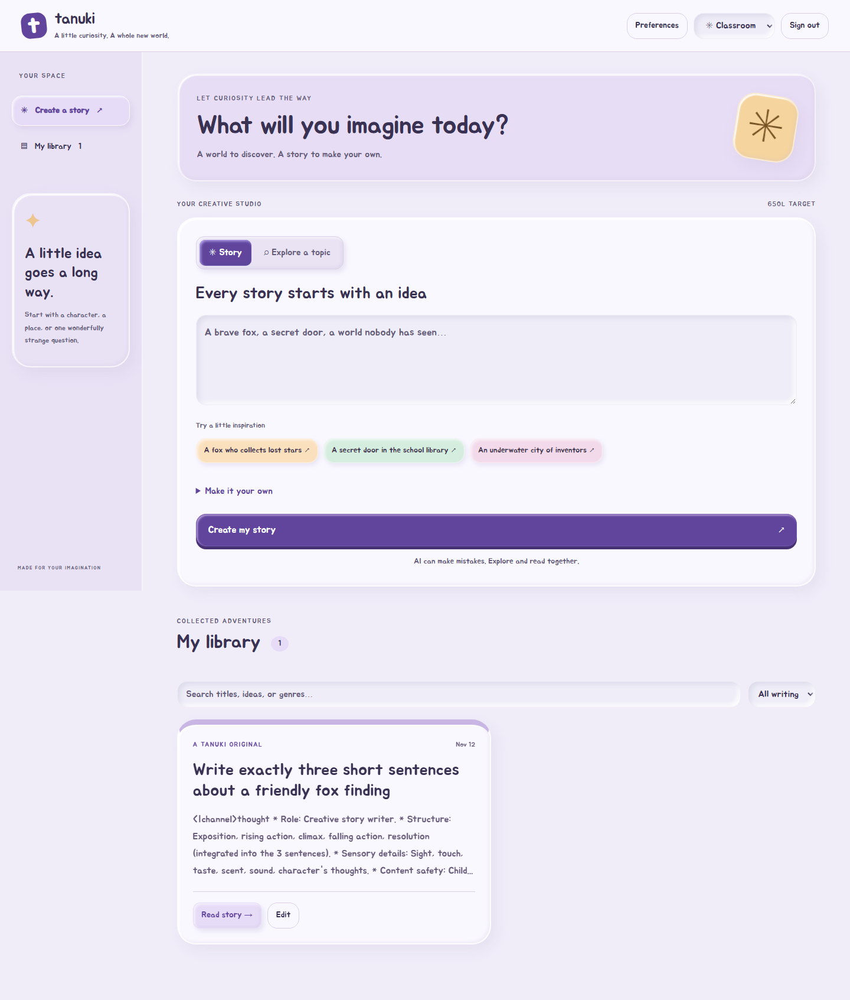

# Windows keyless-provider acceptance — recorded 2026-11-13

The Windows server installer from CI run 43114486046 was installed into the authorized
`E:\proj\tanukitest` directory. Its SHA-256 matched the CI checksum manifest, all
**588 installed payload files** verified, and its runtime reports **Node 26.13.1**.

Using updated checkout setup code and the installed production server, the real
KoboldCpp instance at `http://127.0.0.1:8080/v1` generated a 2,271-character response
without an API key. Eleven acceptance checks passed: provisioning, startup, HTTPS
login/cookies/cache controls, synthetic accounts, persisted Lexile/theme preferences,
real generation, cross-account isolation, Windows Chromium rendering, forced-restart
recovery, logout revocation and absence of plaintext passwords in tested persistent
files. The [machine-readable result](evidence/windows-kobold-2026-11-13/result.json)
contains no passwords, provider secrets or private keys.

The response included model-specific reasoning text. Transport and storage succeeded;
this is **not** evidence of satisfactory narrative quality or classroom content safety.
The native Tauri client was not exercised by this run. TLS used disposable fixture
certificates, explicitly trusted by the Node test client and accepted only within the
isolated browser context; no Windows trust-store settings were changed.

The original installed payload was not patched in place. The keyless setup change is
in source and must be included in the next installer build. Test profiles are retained
for inspection and the test server/proxy/browser were stopped. KoboldCpp was left running.

Regression results for the keyless-provider change: **745 passed, 0 failed, 0 skipped**
in WSL2 on Node 26.13.1. The focused Windows installer/provider suite passed
**15/15**, with no failures or skips. Existing rotation assertions were updated to
treat an empty key as valid, while preserving rejection of missing destinations and
checking that key removal is durably stored in the authenticated provider envelope.

### Listener and local-origin follow-up

The installed launcher now accepts `HOST=0.0.0.0` or a saved setup listening address.
Existing profiles default to loopback. A direct local browser request is permitted
when Origin and Host match localhost/loopback on the actual listener port, the TCP
peer is loopback, no forwarding headers are present, and Fetch Metadata does not
indicate a cross-site request. Public-origin policy and authentication remain enforced.

Windows focused verification: **18 passed, 0 failed, 0 skipped**, including real
Chromium login on localhost and 127.0.0.1 with production Secure/HttpOnly cookies.
Full WSL2 suite: **752 passed, 0 failed, 0 skipped**. Remote HTTP access is not enabled
by this exception; remote browsers still use the configured HTTPS origin.
